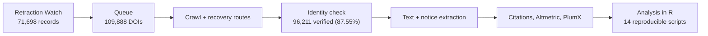
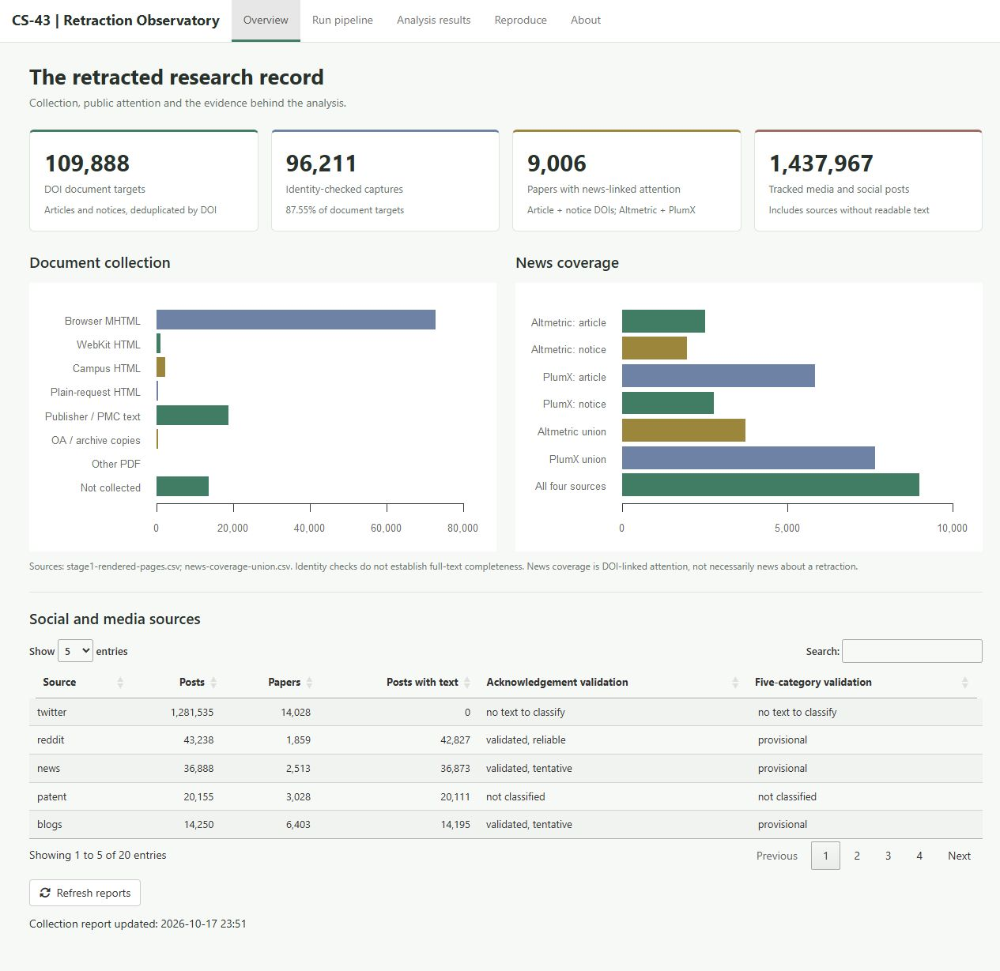
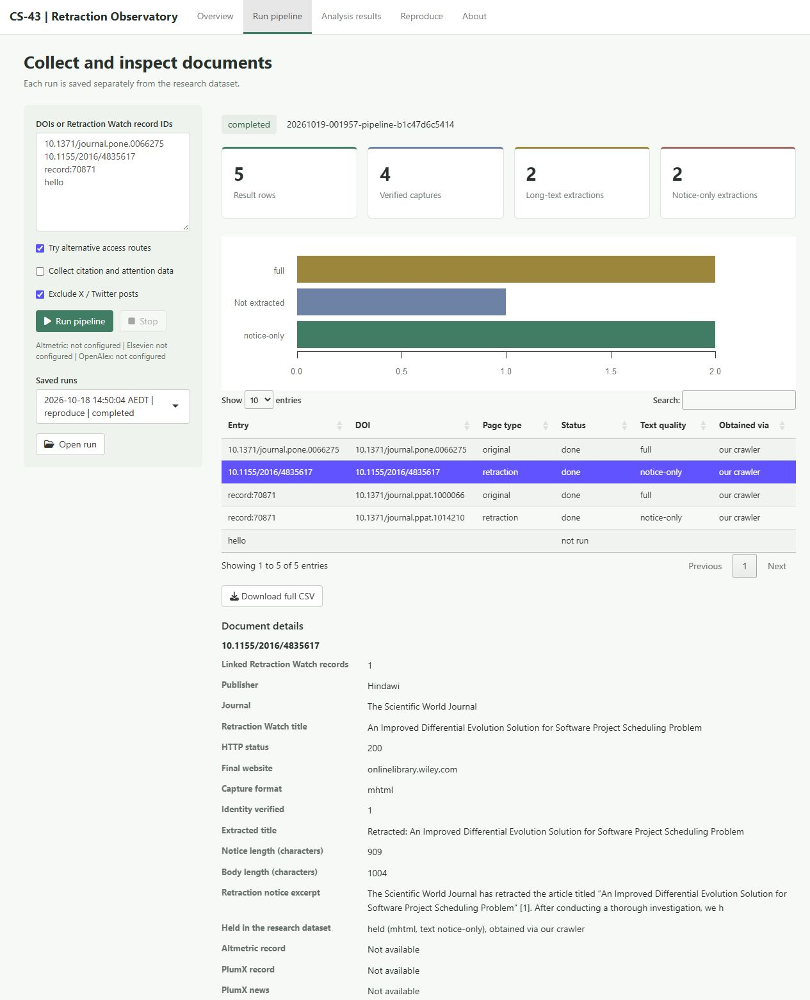
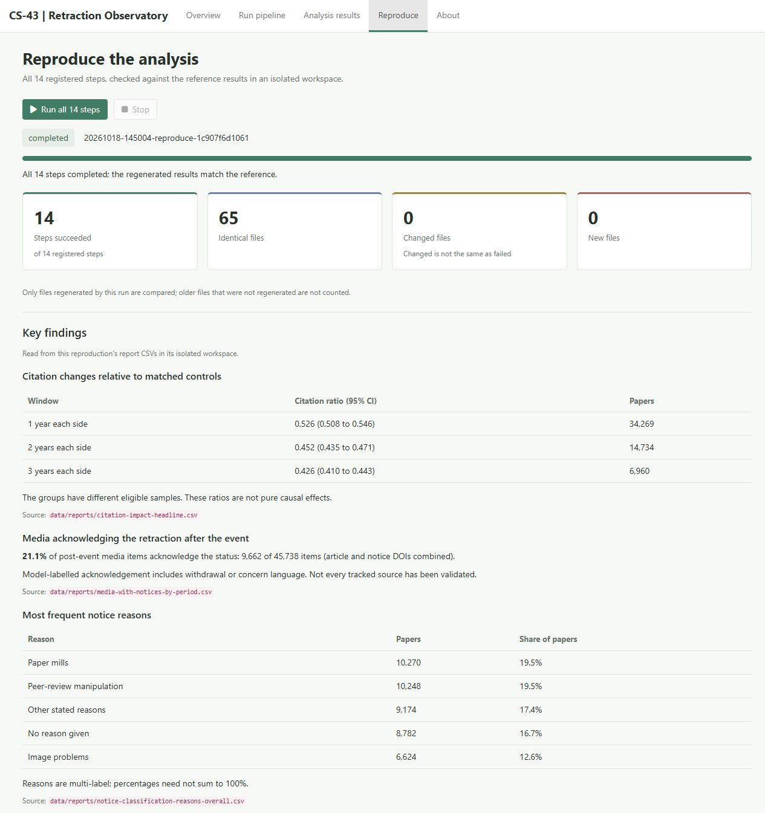
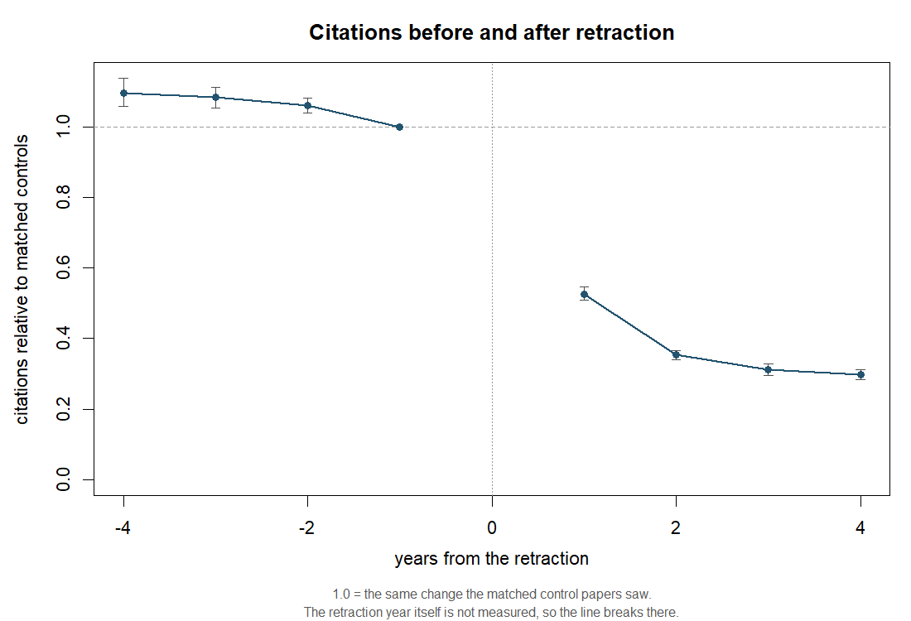
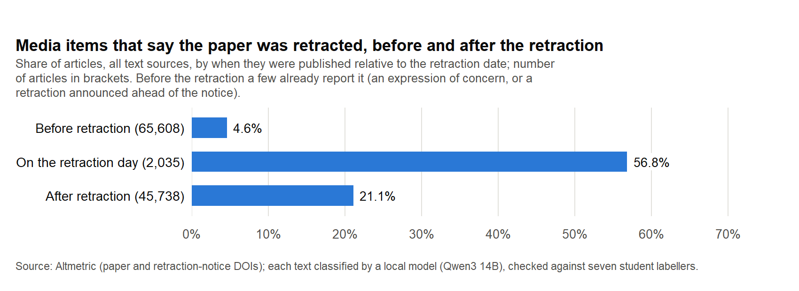
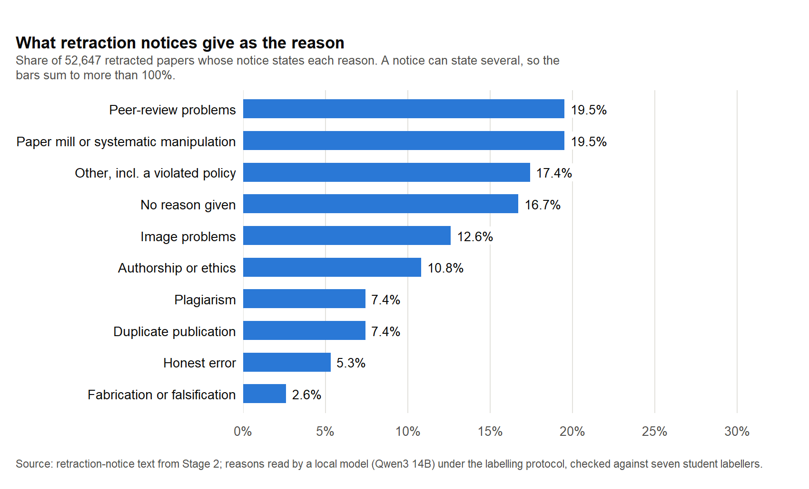

# Retraction Impact Pipeline

What happens to a scientific paper after it is retracted? For every record in
the Retraction Watch database, this project collects the retracted paper's page
and its retraction notice, extracts their text, and measures three things: how
the paper's citations change against matched non-retracted controls, whether
news and social media that mention the paper tell their readers it was
retracted, and what reasons the notices give and how clearly. A retraction
corrects the record only if the correction reaches the people who use it; these
are measurements of whether it does.

Designed and built by Xiangsheng Bao, University of Sydney (COMP5703 capstone,
Semester 2 2026). Contact: xbao0816@uni.sydney.edu.au.

**Headline results** (details and uncertainty under [Results](#results)):

- Within a year of retraction a paper's citations fall to **0.53** of what
  matched non-retracted controls receive (95% CI 0.51-0.55), and to 0.43 at
  three years.
- Of 45,738 news, blog and social-media items published after a paper's
  retraction, **21.1%** tell readers it was retracted; for news it is 16.2%.
- The most common stated reasons for retraction are paper mills and
  compromised peer review (19.5% of papers each); 16.7% of papers' notices give
  no reason at all.

Every number below is read from a file. Paths are relative to this repository
unless marked *dataset*: a file in the non-public dataset (see
[Data availability](#data-availability)).

## What I built

- **A crawler that renders publisher pages and saves them as MHTML**, with a
  per-host rate limiter, a WebKit fallback and recovery routes for pages
  a publisher refuses (`src/rwpipe/fetch.py`, `scripts/crawl.py`,
  `scripts/collect_*.py`).
- **An identity check** that accepts a saved page only if it is the paper
  asked for - by its own DOI metadata or a matching title, never by HTTP status
  or size (`src/rwpipe/identity.py`, `scripts/verify_archives.py`).
- **Text and notice extraction** for MHTML, HTML, publisher XML, JATS and PDF,
  versioned and re-run in place when the rules change (`src/rwpipe/extract.py`,
  `scripts/extract_text.py`, now at version 15).
- **Engagement collection:** OpenAlex citations, Altmetric and PlumX attention,
  on paper and notice DOIs (`scripts/collect_engagement.py`,
  `scripts/collect_altmetric*.py`, `scripts/collect_plumx.py`).
- **The analysis in R:** a matched control group, a difference-in-differences
  citation comparison with placebo and robustness checks, media and notice
  classification with a local open-weight model (Qwen3 14B), validated against
  human labels with a written protocol (`R/`, `analysis/`).
- **An interface** (`cs43_app()`, Shiny): run the pipeline on chosen DOIs
  with a live log and inspect every document and its saved page, browse the
  results by reason, country, publisher and discipline, and re-run all 14
  analyses with one button (`R/app.R`).
- **Reproducibility:** one R entry point (`run.R`), pinned R packages (renv)
  and Python requirements, `reproduce_results()` that re-runs all 14 analyses
  and compares every output with recorded checksums, and 701 Python tests and
  18 R test suites (`tests/`).



## Interface

`cs43_app()` opens a local dashboard in the browser.



Running the pipeline on chosen entries: an invalid entry is reported as not
run with the reason, and each document's details and saved page are one
click away.



Reproducing every analysis in a separate copy, checked against the recorded
results, then the key findings:



## Scale

| | | Source |
|---|---:|---|
| Retraction Watch records | 71,698 | `data/reports/client-data-sheet.csv` |
| distinct DOIs to collect (paper and notice pages) | 109,888 | same |
| documents collected and verified by identity | 96,211 (87.55%) | *dataset* `data/clean/stage2_index.csv`; `data/reports/stage1-rendered-pages.csv` |
| ... with full article text / the notice only | 44,411 / 51,386 | *dataset* `stage2_index.csv`, column `quality` |
| pages not collected, each with a recorded cause | 13,677 | `data/reports/stage1-rendered-pages.csv` |
| retracted papers (original DOIs) with tracked news on the paper or notice DOI | 9,006 of 62,867 (14.3%) | `data/reports/news-coverage-union.csv`, `news-coverage-population.csv` |
| media articles classified, each counted once | 113,381 | `data/reports/media-with-notices-by-period.csv` (sum) |
| retracted papers in the citation comparison (k = 1) | 34,269, with 98,015 controls | `data/reports/citation-impact-headline.csv` |

## Two rules the project rests on

**A capture counts by identity, not by status code or size.** ScienceDirect
answers HTTP 200 with about 875 KB of scripts around the sentence "There was a
problem providing the content you requested"; 10,049 such captures held no
article, and 228 pages had been filed under a DOI the page does not carry
(`src/rwpipe/fetch.py`, `contains_doi`). Of the 13,677 pages still not
collected, 2,311 last returned HTTP 200 (mostly human-verification pages,
interstitials and PubMed Central opt-outs), and the 293 MHTML pages rejected by
the content check have a median size of 400 KiB against 446 KiB for the pages
kept (`data/reports/stage1-rendered-pages.csv`). A document is accepted when
its own DOI metadata, a clearly labelled visible DOI, a reviewed alias or a
matching title identifies it; a DOI in the request URL, an archive toolbar or
the references does not (`src/rwpipe/identity.py`). The verdict is stored per
document, so it can be checked and disputed.

**Every number carries the sample it was computed on.** Asked what share of
media articles published after the retraction say the paper was retracted,
the data give 15.8% for the 37,211 articles filed under paper DOIs, 46.8% for
the 12,859 filed under notice DOIs, and 21.1% for the 45,738 articles of both,
each counted once (`data/reports/media-with-notices.csv`). All three are
correct; only the third answers the question, and none can be checked without
its sample.

## Access routes

Many publishers refuse automated browsers. The project did not forge TLS
fingerprints, solve CAPTCHAs or rotate proxies (`docs/blocking-strategy.md`);
it added sanctioned routes: publisher APIs and licences, PubMed Central, the
University network, open repositories and the Internet Archive. Verified documents
by route (*dataset* `stage2_index.csv`, columns `source_kind` and
`capture_format`); XML and HTML documents are never presented as MHTML:

| Route | Documents | Format |
|---|---:|---|
| publisher page rendered in Chromium, saved as MHTML via CDP | 68,818 | MHTML |
| publisher page via WebKit (hosts refusing Chromium) or a plain request | 1,258 | HTML |
| Elsevier Article Retrieval API (text and data mining access) | 10,879 | Elsevier XML |
| PubMed Central, NCBI E-utilities `efetch` | 5,425 | JATS XML |
| Taylor & Francis, browser-saved pages supplied as a batch | 2,558 | MHTML |
| IOP delivery under the University's text and data mining licence | 2,552 | JATS XML |
| University network, for hosts that refuse a residential address | 2,377 | HTML |
| SAGE, browser-saved pages supplied as a batch | 1,595 | MHTML |
| open-access mirrors and repositories | 392 | MHTML |
| long tail (plain HTTP 278, Crossref-registered URL 44) | 322 | HTML, 1 PDF |
| Internet Archive | 35 | HTML |
| **total** | **96,211** | |

## Architecture

- **R is the entry point.** `source("run.R")` loads everything; `cs43_help()`
  lists what can be run. R 4.6.1, packages pinned in `renv.lock` to a dated
  Posit Package Manager snapshot, so a restore installs the same binaries
  later without a compiler.
- **Stages 1-2 (collection, extraction) are Python, called from R.** The code
  is in `src/rwpipe/` and `scripts/`. `R/python.R` builds the environment from
  the pinned `requirements.txt` through reticulate and uv; `R/stages.R` runs
  each step as a child process. `run_pipeline()` (`R/handover.R`) collects
  pages, text, citations and attention data for chosen DOIs into a separate
  folder, never into the dataset.
- **Stage 3 (analysis) is R:** control matching (`R/control_group.R`), the
  citation comparison (`R/did.R`), labelling agreement (`R/labelling.R`) and
  classification by an open-weight Qwen3 14B model run locally (`R/llm.R`).
  Its prompts follow the labelling protocol (`docs/labelling-protocol.md`);
  every answer carries a quoted reason, and `R/llm_evidence.R` checks that the
  quote is in the text.
- **One call reproduces the results.** `reproduce_results()` (`R/reproduce.R`)
  runs the 14 scripts in `analysis/` that write `data/reports/`, each in its
  own R process, and compares every output with the reference checksums in
  `data/reports_reference.csv`. Methods notes are in `docs/`.
- **Tests:** 701 Python tests (`tests/`, pytest) and 18 R suites
  (`tests/r/test_*.R`).

## Results

### Citations after retraction, against matched controls

Each retracted paper has up to three non-retracted controls from OpenAlex,
drawn at random from the same journal, publication year and type, or from the
same field where the journal has too few (`R/control_group.R`). The estimate
is a ratio of ratios: the retracted papers' citations k years after against k
years before, divided by the same change for their controls, pooled over
strata in Mantel-Haenszel form, with a 95% interval from 1,000 bootstrap draws
over strata (`R/did.R`, `analysis/citation_impact.R`). 1 means no difference.

| Window | Papers | Controls | Ratio | 95% CI |
|---|---:|---:|---:|---|
| k = 1 year each side | 34,269 | 98,015 | 0.526 | 0.508 - 0.546 |
| k = 2 years each side | 14,734 | 43,659 | 0.452 | 0.435 - 0.471 |
| k = 3 years each side | 6,960 | 21,439 | 0.426 | 0.410 - 0.443 |

Source: `data/reports/citation-impact-headline.csv`. At k = 1 the retracted
papers' citations fell to 0.70 of the year before while their controls' rose
to 1.39 (`treated_change`, `control_change`): retracted papers ended with about
half the citations their controls' trajectory implies. Averaging per-paper
ratios instead would have reported 0.774 (`naive_wrong`).

**Placebo.** Moving both windows back before the retraction, where the true
value is 1.000, gives 0.943 (0.924 - 0.962) at k = 1 and 0.947 (0.926 - 0.968)
at k = 2 (`data/reports/citation-impact-placebo.csv`). Retracted papers were
already losing ground before retraction, so the result is a fall relative to
matched controls, not a pure causal effect; net of a drift that continued
unchanged, k = 1 would be 0.558 (same file), a bound rather than a correction.
Re-dealing each group's controls among its papers with five other seeds gives
0.525 to 0.528 (`data/reports/citation-impact-redeal.csv`).



### Does coverage after retraction tell readers?

Media articles published after the paper's retraction that say it was
retracted or withdrawn, by source with at least 50 such articles
(`data/reports/media-with-notices-by-kind.csv`):

| Source | Articles | Say retracted |
|---|---:|---:|
| blogs | 6,390 | 48.1% |
| Bluesky | 1,757 | 41.4% |
| Facebook | 2,542 | 31.2% |
| news | 14,343 | 16.2% |
| Google+ | 502 | 14.9% |
| Reddit | 18,958 | 13.7% |
| Q&A | 84 | 11.9% |
| podcasts | 337 | 6.8% |
| video | 848 | 5.7% |

Across all sources: 21.1% of 45,738 articles after the retraction, 56.8% of
2,035 on the day, 4.6% of 65,608 before it
(`data/reports/media-with-notices-by-period.csv`). Of the 7,928 papers
mentioned after retraction (leaving out papers reached only through
mass-retraction notices), 4,775 (60.2%) are described as retracted at least
once (`data/reports/media-with-notices.csv`).



Uncertainty. On "does the item tell the reader it was retracted?" the model
matched the seven labellers' majority on 92.4% of 197 items (Cohen's kappa
0.82); the labellers' own Krippendorff alpha was 0.77
(`data/reports/llm-validation.csv`, prompt v2), and 0.86 on 100 social-media
items (`data/reports/labelling-round2.csv`). In a sample of 4,000 answers,
2,693 quoted evidence found in the text and 439 quoted text that is not there
(`data/reports/media-classification-evidence-check-sample.csv`). The finer
five categories (repeats the finding, questions it, unrelated, ...) are not
used for conclusions: the labellers' alpha on them was 0.59
(`data/reports/labelling-agreement.csv`).

### What retraction notices say

Reasons stated in the notice, as a share of retracted papers with a classified
notice; a notice can state several
(`data/reports/notice-classification-reasons-overall.csv`). Kappa is the model
against the seven-labeller majority on 200 validation notices
(`data/reports/llm-validation.csv`).

| Reason | Papers | Share | Kappa |
|---|---:|---:|---:|
| paper mill | 10,270 | 19.5% | 0.86 |
| compromised peer review | 10,248 | 19.5% | 0.96 |
| other | 9,174 | 17.4% | below |
| no reason given | 8,782 | 16.7% | below |
| image problems | 6,624 | 12.6% | 0.95 |
| authorship or ethics | 5,694 | 10.8% | 0.94 |
| duplicate publication | 3,910 | 7.4% | 1.00 |
| plagiarism | 3,888 | 7.4% | 0.85 |
| honest error | 2,793 | 5.3% | 0.74 |
| fabrication or falsification | 1,362 | 2.6% | 0.66 |



The model over-called "no reason" (46 notices against the labellers' 20) where
a notice cites a policy violation. A rule taken from the protocol's own
definition moves those to "other"; after it, agreement with the majority is
97.5% for "no reason" and 88.9% for "other" on 199 notices
(`data/reports/notice-r0-check.csv`). Clarity, for the 52,647 papers with a
rating: no reason 10.0%, vague 50.9%, partial 18.0%, clear 21.1%
(`data/reports/notice-classification-clarity-overall.csv`). These shares are
indicative only: the labellers' alpha on clarity was 0.55 and the model's
kappa 0.34 (`data/reports/llm-validation.csv`).

Breakdowns by reason, country, publisher and discipline are the
`data/reports/*-by-*.csv` tables; figures are in `data/reports/figures/`.

## How to run

```r
renv::restore()
source("run.R")
cs43_help()
reproduce_results()          # needs the dataset; no API keys, no model server
cs43_app()                   # the interface in the browser

use_pipeline_python()        # collection: first-time setup, needs internet
install_browser()
Sys.setenv(RWPIPE_CONTACT = "your.email@example.edu")
res <- run_pipeline(c("10.1371/journal.pone.0066275", "record:70871"))
```

Tests: `python -m pytest -q`, and `Rscript --vanilla tests/r/test_<name>.R`
for each R suite. In this public copy 697 Python tests pass and 4 skip (a
local audit capture is not distributed); 17 of the 18 R suites pass, and
`test_analysis_data.R` reports its four dataset archives missing because the
dataset is not included. [HANDOVER.md](HANDOVER.md) is the full user guide:
installing the dataset, API keys, collecting selected DOIs, Windows and macOS.

## Data availability

The dataset is not public. With the saved pages it is about 53 GB
(`HANDOVER.md`), and it includes publisher full texts obtained under text and
data mining terms that allow analysis, not redistribution, so it is held
under University of Sydney licences. This repository holds the code,
tests, methods documents and result tables and figures: 134 of the 157 outputs
listed by the project's checksum reference. The other 23 are withheld: 22
contain long text fields or bulk excerpts of notice text, and one holds
per-labeller figures. Labellers appear as Labeller A to G, and per-labeller
rows are left out of `data/reports/labelling-agreement.csv`. Code comments that cite "the project log" refer to the
author's dated development log, which is not published.

## Limitations

- **Coverage.** 13,677 of 109,888 pages were not collected; for 6,293 the last
  response was HTTP 403 (`data/reports/stage1-rendered-pages.csv`).
- **Identity is not completeness.** 11,920 article pages kept as MHTML have a
  body under 5,000 characters and no extracted abstract, so their content is
  undetermined (same file); 51,386 of the 96,211 documents are the notice only.
- **News is tracked DOI mentions** (Altmetric; PlumX gives counts without
  dates or text), not unique stories, and not necessarily about the retraction.
  757 of the 9,006 papers with news have no Retraction record, only other
  record types such as corrections or expressions of concern
  (`data/reports/news-coverage-population.csv`); the media prompt assumes a
  retraction.
- **Citations.** OpenAlex counts by year, so the retraction year is excluded
  and windows must fit 2012-2025: 34,269 of 57,824 eligible papers enter at
  k = 1 (`data/reports/citation-impact-funnel.csv`). The placebo shows a
  pre-existing drift; the estimate is not causal.
- **Validation size.** Each labelled task has 100 to 200 items, seven labellers.
